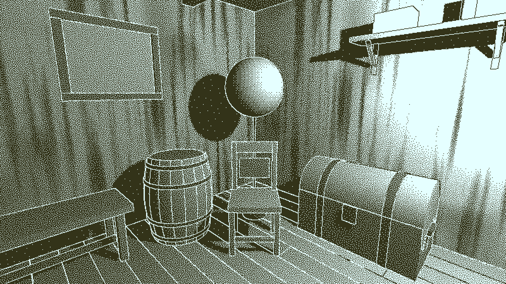

# Dithering FTW

A recreation in Bevy of the 1-bit rendering experiments from Lucas Pope's
[Return of the Obra Dinn devlog](https://dukope.com/devlogs/obra-dinn/tig-32/) ("Fullscreen, Round 3"),
in a similar test scene: a ship's cabin corner with a chair, a sphere on a stand, a barrel, a bench,
a framed picture, a sea chest and a wall shelf.

* Install a >1.97.0 rust toolchain.
* Use `cargo run --release` to start the demo.
* Use `cargo check --release --all-targets` to check everything is ok.
* Use `cargo test --release --all-targets` to run the tests.
* Use `./deploy.sh` to build the wasm version into `../demo_public/dithering_ftw`.

## Pipeline

* The scene renders in 8-bit grayscale to an offscreen image, along with a dither pattern selector,
  region ids for the wireframe lines and view depth.
* A post-processing pass converts it to 1-bit at 800x450 by comparing each pixel to a dither pattern:
  an 8x8 bayer matrix (sphere) or a 128x128 blue noise field (everything else).
* The result is upscaled to the window with a two color palette.

## Dither pattern mappings

* `screen`: pattern fixed to the screen, swims when the camera moves.
* `screen+offset`: pattern shifted by `ScreenSize * CameraRotation / CameraFov`.
* `texel`: pattern mapped with the mesh uvs, thresholded during scene rendering.
* `motion warp`: pattern warped along with the scene using depth and the previous frame.
* `cube`: pattern on a world aligned cube around the camera.
* `sphere`: pattern on a "rings" mapped sphere around the camera, best with 2x supersampling.

## Presets

* `F1` DIGITAL: border-boxed, screenspace offset dither, 1-bit output.
* `F2` ANALOG: fullscreen, sphere-mapped dither, 2x supersampling, softened output.

## Keyboard and mouse controls

* 1-6: dither pattern mapping.
* V: view, either 1-bit output, 8-bit source, dither pattern or flat gray.
* B: dither pattern, per object, bayer or blue noise.
* P: palette.
* F: display, digital or analog.
* X: 2x supersampling.
* T: final 50% threshold after downsampling.
* E: wireframe edges.
* Right mouse drag or arrows: look around.
* WASD: walk.
* Space: auto pan.
* M: move the sphere.
* H: hide the ui.
* F12: save a snapshot.
* Escape: quit.
